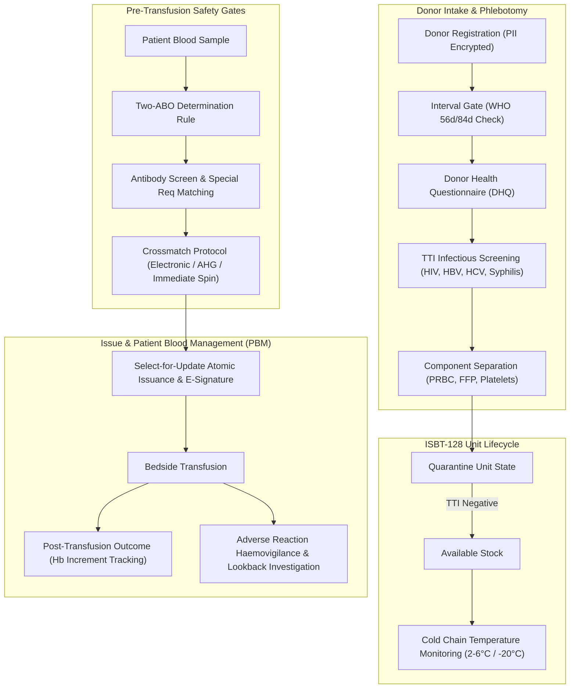

# 🩸 BloodBank LIS

> **Clinical-Grade Laboratory Information System (LIS) & Hemovigilance Platform**  
> *Engineered to meet AABB Technical Manual (22nd ed.), WHO Guidelines, BSH Criteria, and FDA 21 CFR Part 11 Audit Integrity Standards.*

[](https://opensource.org/licenses/MIT)
[](https://www.python.org/)
[](https://www.djangoproject.com/)
[](https://www.postgresql.org/)
[](https://github.com/Coder-0X/BBMS)
[](https://github.com/Coder-0X/BBMS)

---

## 📌 Executive Overview

**BloodBank LIS** is a full-featured, zero-licensing-cost clinical laboratory information system engineered for blood transfusion services, donor centers, and hospital pathology departments. Unlike standard inventory databases, this platform enforces strict **transfusion safety gates**, **electronic crossmatching**, **haemovigilance incident investigation**, and **tamper-evident audit logging** to eliminate preventable clerical errors and ABO-incompatibility events.

The platform is designed around 12 decoupled domain modules following healthcare regulatory standards:

```
bloodbank/
├── accounts/      # Role-based access control (RBAC), SoD, TOTP MFA
├── analytics/     # Demand forecasting, wastage tracking, KPI dashboards
├── audit/         # SHA-256 cryptographic hash-chained audit ledger, e-signatures
├── coldchain/     # Refrigerator/freezer temperature logging & excursion alerts
├── compliance/    # WHO / AABB configurable donor & unit regulatory rule engine
├── core/          # Branch management, system alerts, PDF report generation
├── donors/        # Donor registry, TTI infectious disease testing, deferrals, milestones
├── inventory/     # ISBT 128 barcode labeling, unit state transitions, component split
├── patients/      # Patient ABO/Rh confirmation, antibody registry, transfusion history
├── privacy/       # SubjectIdentity surrogate keys, AES-256-GCM PII encryption
├── quality/       # Deviations, CAPA workflows, non-conformance tracking
└── transfusion/   # Electronic XM, two-ABO gating, reaction investigation, PBM dashboard
```

---

## 🏛️ Clinical Transfusion Architecture



---

## 🛡️ Key Clinical Safety Mechanisms

### 1. Two-ABO Determination Rule
In compliance with AABB Chapter 12 and British Committee for Standards in Haematology (BCSH) guidelines, group-specific blood units are permanently blocked from issuance until **at least two independent concordant ABO/Rh determinations** are validated in the patient registry (drawn on separate venipunctures or confirmed by historical laboratory records).

### 2. WHO Donation Interval Enforcement
Prevents donor iron-deficiency anemia and phlebotomy exhaustion via automated recovery gates:
- **Whole Blood (Male)**: Minimum 56 days (8 weeks).
- **Whole Blood (Female)**: Minimum 84 days (12 weeks) for iron store replenishment.
- **Apheresis Platelets**: Minimum 14 days.
- **Apheresis Plasma**: Minimum 28 days.
- Real-time countdown telemetry displays exact remaining deferral days on the donor profile.

### 3. Electronic Crossmatch (Computerized XM) Eligibility
Automated validation gates allow electronic crossmatch only when:
1. Patient has $\ge 2$ concordant ABO/Rh results on file.
2. Current antibody screen is confirmed negative.
3. Patient historical record contains no clinically significant unexpected antibodies.
4. Unit donor ABO/Rh confirmation re-testing is verified.

### 4. Tamper-Evident SHA-256 Audit Chain
Every clinical transaction (donor deferral, blood issue, crossmatch verification, emergency release) generates an immutable ledger entry containing:
$$\text{Hash}_n = \text{SHA256}(\text{Record Payload}_n \parallel \text{Hash}_{n-1} \parallel \text{Timestamp})$$
Any manual SQL modification or out-of-band record tampering breaks the cryptographic chain and triggers an immediate compliance integrity alarm.

### 5. Cold Chain Temperature Integrity
Monitors storage units (refrigerators: 2°C–6°C, freezers: $\le -20$°C, platelet agitators: 20°C–24°C). If temperature excursions exceed maximum allowable dwell time (e.g., >30 minutes out of controlled temperature), units are automatically flagged and placed into administrative quarantine.

---

## 🧪 Automated Testing & Quality Assurance

The system maintains **33 comprehensive test suites** covering safety protocols:

```bash
pytest
```

Key test coverage areas:
- `test_abo_compatibility.py`: Universal donor/recipient rules (O-neg RBC, AB plasma).
- `test_compliance_engine.py`: WHO/AABB vital threshold rules (Hb, BP, weight, interval).
- `test_coldchain.py`: Temperature excursion escalation and safe return verification.
- `test_transfusion_views.py`: Emergency uncrossmatched release and crossmatch workflows.
- `test_audit.py`: Cryptographic hash chain validation and tamper detection.
- `test_safety.py`: Select-for-update race condition prevention during simultaneous unit allocations.

---

## 📂 Repository Structure

```
bloodbank-app/
├── accounts/               # User authentication, RBAC, TOTP MFA, SoD
├── analytics/              # Usage forecasting, seasonal stock metrics
├── audit/                  # Hash-chained immutable audit ledger
├── coldchain/              # Temperature logger integration & alerts
├── compliance/             # AABB / WHO regulatory ruleset engine
├── core/                   # Branch configuration, alerts, PDF engine
├── donors/                 # Donor lifecycle, DHQ, donation intervals
├── inventory/              # Unit state machine, ISBT-128 labeling
├── patients/               # Patient blood group registry & history
├── privacy/                # Encrypted PII with AES-256-GCM
├── quality/                # Deviations, non-conformance, CAPA
├── research/               # Clinical research dossiers & standards analysis
│   ├── DEEP-RESEARCH-REPORT-2026.md
│   ├── REQUIREMENTS-BEST.md
│   ├── lane-clinical-workflow.md
│   └── lane-compliance.md
├── templates/              # Clinical dashboard & operational templates
├── tests/                  # 33 comprehensive automated test suites
├── requirements.txt
└── manage.py
```

---

## 🚀 Getting Started

### Prerequisites
- **Python**: 3.10+
- **PostgreSQL**: 14+ (or SQLite for local development)
- **Virtual Environment** (`venv`)

### 1. Installation

```bash
# Clone repository
git clone https://github.com/Coder-0X/BBMS.git
cd BBMS

# Create and activate virtual environment
python -m venv venv
# Windows:
venv\Scripts\activate
# Linux/macOS:
source venv/bin/activate

# Install dependencies
pip install -r requirements.txt
```

### 2. Environment Configuration

```bash
cp .env.example .env
# Open .env and set your SECRET_KEY and DB credentials
```

### 3. Database Migration & Initialization

```bash
# Run migrations
python manage.py makemigrations core accounts audit compliance privacy donors inventory patients transfusion
python manage.py migrate

# Create administrator account
python manage.py createsuperuser

# Start development server
python manage.py runserver
```

Navigate to `http://127.0.0.1:8000` to access the BloodBank LIS portal.

---

## 📄 License

Distributed under the **MIT License**. See `LICENSE` for details.

---

## 👨‍💻 Author

**Coder-0X**
- GitHub: [@Coder-0X](https://github.com/Coder-0X)
